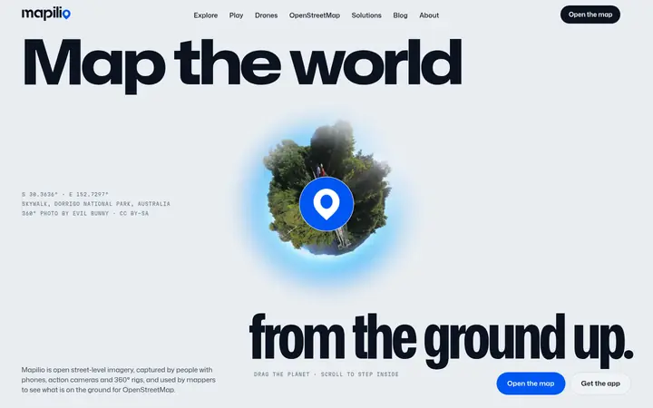
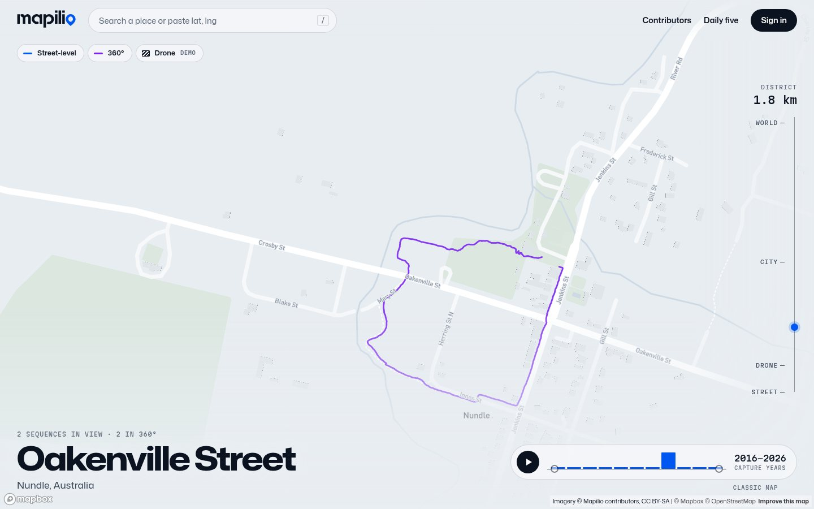
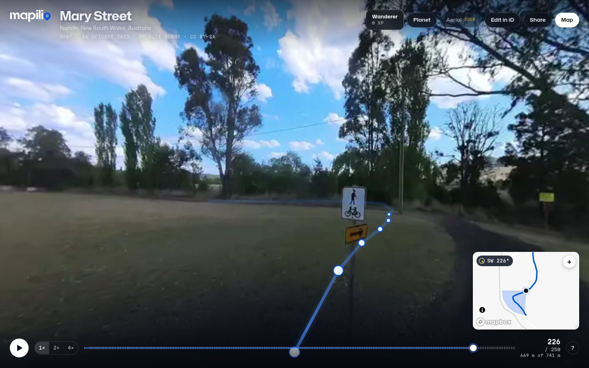
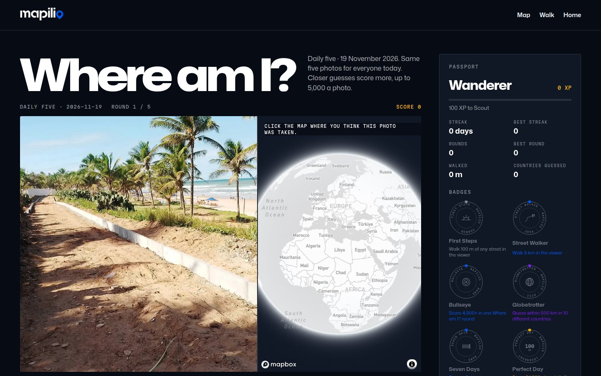
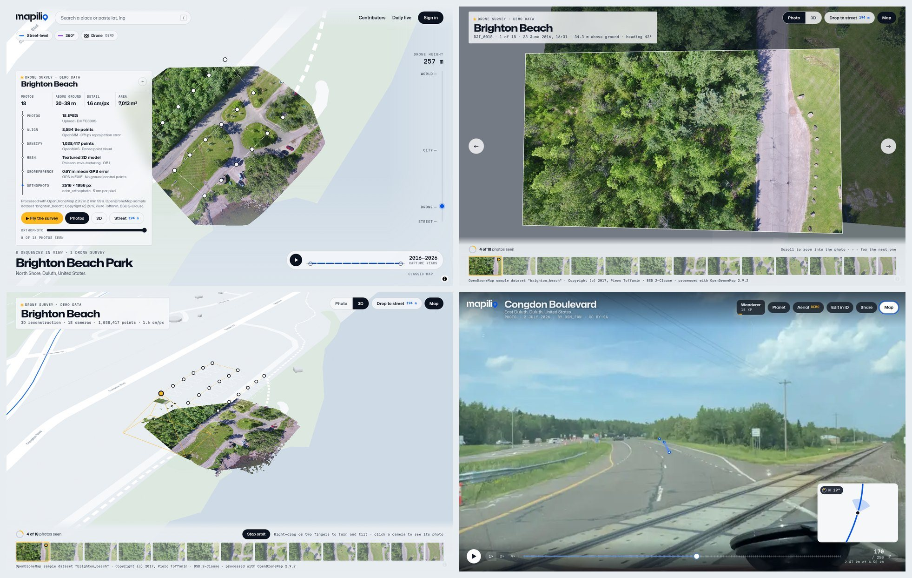

<p align="center">
  
</p>

<h1 align="center">Mapilio web app</h1>

<p align="center">
  Street-level and 360° imagery for OpenStreetMap, in the browser.<br>
  A map you can fly into, a street viewer that opens iD on the photo you are looking at, a daily geo game and a drone demo.
</p>

<p align="center">
  <a href="https://dev.mapilio.com"><b>Try it on dev.mapilio.com</b></a> ·
  <a href="https://github.com/mapilio/platform/issues/new/choose">Report a bug or suggest an idea</a> ·
  <a href="https://mapilio.com">mapilio.com</a>
</p>

<p align="center">
  <a href="LICENSE"></a>
  
  <a href="https://github.com/mapilio/platform/actions/workflows/ci.yml"></a>
</p>

> **Beta.** The design is not final. We are shaping it with feedback from mappers and contributors, so tell us what works and what doesn't in the [issues](https://github.com/mapilio/platform/issues).

| Map | Street viewer |
| --- | --- |
| [](https://dev.mapilio.com/app?lat=-31.4594&lng=151.1243&zoom=15.6) | [](https://dev.mapilio.com/app/walk?seq=559fc722-b27e-4bbb-97ba-30698a5fcaab&photo=4132014) |
| **Daily five** | **Drone demo** |
| [](https://dev.mapilio.com/app/play) | [](https://dev.mapilio.com/app?drone=brighton-beach) |

## What's in here

**Homepage** (`/`). A scroll story built from one real 360° walk: you start inside a panorama, walk a few frames, rise until the photos become lines on a map, then a globe with everyone's coverage. Rendered with three.js.

**Map** (`/app`). A Mapbox GL JS globe with Mapilio coverage: 360° sequences in violet, other photos in blue. Filter by capture year, search for a place or paste `lat, lng`, and zoom in until the camera lands in the street.

**Street viewer** (`/app/walk`). Drag to look around, click ahead or press the up arrow to walk. **Edit in iD** opens OpenStreetMap's editor at the same spot with the Mapilio layer on and the photo selected.

**Daily five** (`/app/play`). Five photos a day, the same for everyone. Guess where each was taken; the closer, the more points. Levels, streaks and badges are kept in your browser.

**Drone demo** (`/app?drone=brighton-beach`). How drone imagery could sit next to street-level imagery, using OpenDroneMap's public "brighton_beach" sample. Mapilio has no drone uploads yet.

The classic map, accounts and uploads are part of mapilio.com and not in this repository yet. Links to them go to mapilio.com.

## Run it locally

You need Node.js 18 or newer and a free [Mapbox access token](https://account.mapbox.com/access-tokens/).

```bash
git clone https://github.com/mapilio/platform.git
cd platform
npm install
cp .env.example .env.local   # then add your token
npm run dev
```

Open http://localhost:3000. The app reads Mapilio's public APIs, so there is no backend to set up.

```bash
npm test        # unit tests
npm run build   # production build
```

## Project layout

```
pages/                        routes: /, /app, /app/walk, /app/play
src/views/landing/            homepage; the three.js story stage is in stage/
src/views/platformApp/Atlas/  map, camera flights, drone layer
src/views/platformApp/Walk/   street viewer
src/views/platformApp/Play/   daily game
src/lib/                      game progress, drone survey helpers, panorama shader
public/landing/, public/drone/  prepared assets for the homepage and the drone demo
tests/                        unit tests (node:test)
```

## Contributing

Bug reports, ideas and pull requests are welcome. Please read [CONTRIBUTING.md](CONTRIBUTING.md) first; it explains what to put in an issue so we can act on it.

A photo with a face or licence plate that isn't blurred, or one you want removed, should not go in a public issue. Email info@mapilio.com with the link instead.

## Licence

The code is under the [MIT licence](LICENSE). These are not covered by it:

- the Mapilio name and logo;
- photos in `public/landing/` and everything loaded from Mapilio's APIs: © their contributors, CC BY-SA;
- the drone sample in `public/drone/brighton-beach/`: © 2017 Piero Toffanin, BSD 2-Clause;
- map data: © [OpenStreetMap contributors](https://www.openstreetmap.org/copyright), © Mapbox.
